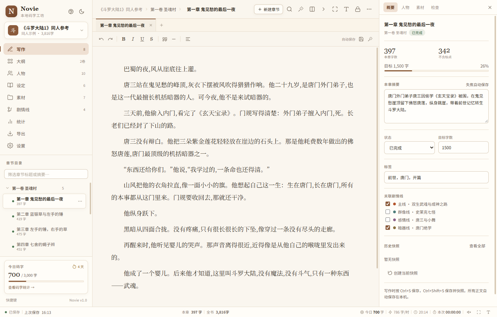

# Novie · 本地优先的网文码字工坊

> 不强制登录、不强制联网、正文默认只存在本机的桌面写作工具。  
> 面向长篇网文连载：写作、大纲、人物、设定、素材、剧情线、导出与备份，在同一条本地数据链上完成。




---

## 目录

- [1. 这是什么](#1-这是什么)
- [2. 已实现功能](#2-已实现功能)
- [3. 相比其他编辑平台的优势](#3-相比其他编辑平台的优势)
- [4. 技术实现](#4-技术实现)
- [5. 创新点](#5-创新点)
- [6. 快速开始](#6-快速开始)
- [7. 数据安全与边界](#7-数据安全与边界)
- [8. 快捷键](#8-快捷键)
- [9. 项目结构](#9-项目结构)
- [10. 测试与验证](#10-测试与验证)
- [11. 已知限制与路线](#11-已知限制与路线)
- [12. 许可与第三方说明](#12-许可与第三方说明)

---

## 1. 这是什么

Novie 是一个**本地优先的长篇网文写作工作台**。它不是又一个通用笔记软件，而是把网文作者真正高频的动作做成了一条闭环：

```text
建书 → 分卷 → 大纲 → 写正文 → 记人物/设定 → 查前文 → 看进度 → 导出/备份
```

设计原则只有四条：

1. **稿子属于作者**：核心功能离线可用，数据落本机，随时可导出。
2. **写长篇不卡**：章节元数据与正文分表，切章按需加载，不把整本书塞进编辑器。
3. **写的时候不被干扰**：无账号、无社区、无资讯、无 AI 弹窗。
4. **数据能带走**：TXT / Markdown / DOCX / PDF / ZIP / JSON / 加密备份。

内置示例是一份 8 章的《斗罗大陆 1》同人重述，用于演示从大纲、人物、剧情线到导出的完整流程；不是原文摘录。项目目录中的参考 TXT 属于用户本地文件，不参与应用构建。

---

## 2. 已实现功能

### 2.1 写作核心

| 模块 | 能力 |
| --- | --- |
| 编辑器 | contenteditable 轻排版：加粗、斜体、下划线、删除线、引用、分割线；纯文本粘贴；中文输入友好；程序性改写（替换 / 排版 / 拆章）保留应用级撤销，Ctrl+Z 可回退 |
| 章节 | 多标签页、卷/章两级目录、拖拽排序、跨卷移动、复制、重命名、删除 |
| 字数 | 实时本章/全书/今日字数，可选含标点或纯文字；时速、本次写作时长 |
| 专注 | 普通 / 专注（隐藏界面）/ 打字机（光标居中）/ 小黑屋（字数 + 时长锁定） |
| 小黑屋 | 目标达成前禁止切章/切书/切视图；重开应用继续锁定；提供需输入确认短语的紧急退出 |
| 排版 | 一键网文排版：清理段首尾空格、空段，中文直引号成对规范为弯引号（`Ctrl+J`） |
| 对照 | 前后文只读分屏；右侧“前文回看”显示前两章摘要 |
| 章节操作 | 光标处拆章、与下一章合并、章节信息/摘要/状态/目标字数/标签/关联剧情线 |

### 2.2 大纲、人物与设定

| 模块 | 能力 |
| --- | --- |
| 大纲 | 按卷分组的卡片视图：摘要、状态、目标进度、剧情线颜色标记；按标题/摘要/标签搜索 |
| 人物档案 | 姓名、别名、定位、性别、身份、外貌、性格、小传、标签、关系、代表色 |
| 人物出场 | 保存章节时扫描姓名/别名自动关联，支持手动重新扫描；右侧人物面板快速插入姓名 |
| 人物星图 | Canvas 实现：**3D 球面投影**（拖动旋转、滚轮缩放、双击定焦、景深近大远小）与 **2D 弹簧引力星云** 双模式；关系类型分色，支持筛选、人物详情、全关系清单 |
| 设定库 | 世界观 / 势力 / 功法 / 物品 / 地点 / 自定义分类；标签与全文检索 |
| 剧情线 | 主线 / 群像 / 感情线 / 身世线等；节点挂接章节、勾选完成、自动计算完成度；总时间轴 |
| 伏笔管理 | 埋设章 / 预计回收章 / 回收章三段关联；超过 50 章或到达预计回收章未收自动标红；剧情线导航显示超期数；一键标记回收 |
| 素材库 | 描写片段、对话、资料摘抄；分类、标签、搜索、一键插入正文、复制 |
| 快捷短语 | 触发词 + `Tab` 展开；`Alt+1~4` 直接插入前四个短语 |

### 2.3 效率与检查

- 全站搜索：全书范围检索，可定位到章节；替换保留 HTML 排版。
- **替换全书前自动逐章留快照**：替换结果可从“历史快照”一键回退；当前章通过编辑器执行，不覆盖替换期间的新输入。
- 敏感词检测：内置示例词库 + 自定义词库；临时标黄、逐词轮换定位、**一键打码**（打码前自动快照）。
- 重复段落检测：找出本章重复的较长段落。
- **章末钩子（断章力度）**：本地规则分析每章结尾——对话 / 悬念 / 短句收尾加分，总结式平铺收尾扣分；统计页按最弱在前列出并给出改写提示。
- 取名器：男性/女性/中性人名、地名、宗门、功法、器物。
- 章节字数分布与均衡提示。
- 创作成就：初次落笔、小有积蓄、三日不辍、千字冲刺、万字长篇、百章连载（本地计算）。
- 打字机音效：Web Audio 合成的轻微按键声，默认关闭。

### 2.4 数据安全

- **自动保存**：输入后约 900ms 写入 IndexedDB；切换章节/视图/窗口隐藏时强制保存。
- **崩溃缓冲**：最近正文额外写入 localStorage，异常退出后重开自动恢复。
- **章节历史快照**：手动与自动（10 分钟节流），每章最多保留 20 份；恢复前自动留“恢复前快照”。
- **整项目备份**：每 30 分钟本机快照（保留 4 份，可恢复为新作品）。
- **加密备份**：AES-GCM 256 + PBKDF2-SHA256 21 万次迭代的 `.noviebak`。
- **作品密码**：界面打开锁（已明确：不是数据库加密）。
- **桌面定时文件备份**：保留最近 10 份 `.novie` 文件。
- **WebDAV**：真实网络请求；连接测试、加密上传、云端恢复；桌面版走主进程，避开浏览器 CORS。**每次上传都是带时间戳的新文件，不覆盖云端旧备份**；恢复时按时间戳取最新。
- **数据健康面板**：设置页展示最近保存 / 快照 / 内部备份 / 文件备份 / WebDAV 上传的时间线（本机最近 120 条）、数据库存储配额与备份新鲜度提醒（超过 7 天未备份标黄）。

### 2.5 导出

| 格式 | 说明 |
| --- | --- |
| TXT | UTF-8 / UTF-8 BOM / GBK；自动分章；GBK 缺字会报告 |
| DOCX | 手写 OOXML + ZIP；封面、可见目录、卷/章样式、首行缩进；不依赖 Office |
| Markdown | 标题、引用、强调等基础转换 |
| 打印 / PDF | 系统打印对话框“另存为 PDF”；封面、目录、章节分页 |
| 分章 ZIP | 每章一个 TXT 或 MD |
| `.novie` | 完整工程 JSON，可迁移、可再导入 |
| `.noviebak` | AES-GCM 加密备份 |

### 2.6 界面

- 四套主题：宣纸 / 护眼 / 极简 / 夜间。
- **太阳/月亮按钮只负责亮暗切换**；调色盘按钮单独打开四套主题选择。
- 字体、字号、行距、版心宽度、首行缩进可调。
- 自定义背景图与透明度。
- 多标签、右键菜单、快捷键、作品切换与管理。

---

## 3. 相比其他编辑平台的优势

> 这里比较的是**定位差异**，不是“功能总量”。竞品在云同步、移动端、社区、生态和成熟度上普遍更强；Novie 胜在数据主权、离线、开放数据和网文专属工作流。

| 维度 | Novie | 橙瓜码字 | 作家助手 | Scrivener / 通用编辑器 |
| --- | --- | --- | --- | --- |
| 数据位置 | 本机 IndexedDB；用户自行备份 | 云账号优先 | 云 + 阅文生态 | 本地文件 |
| 账号 | 不需要 | 需要 | 需要 | 不需要 |
| 离线 | 核心功能完整离线 | 部分功能依赖登录/云 | 依赖账号 | 可离线 |
| 云同步 | 可选 WebDAV 手动快照 | 成熟云同步 | 成熟云同步 | Dropbox / iCloud 等 |
| 移动端 | 无 | 有 | 有 | iOS 版 |
| 社区/拼字 | 无（刻意不做） | 有 | 有 | 无 |
| 网文工具 | 小黑屋、敏感词、取名、GBK、一键排版、剧情线、人物星图 | 完整且成熟 | 围绕阅文投稿 | 通用写作，缺网文专属 |
| 人物关系 | 3D/2D 可交互星图 + 关系筛选 + 全关系清单 | 常规人物卡 | 角色库 | 卡片/大纲，无星图 |
| 开放数据 | JSON / TXT / MD / DOCX / PDF / ZIP | 以平台导出为主 | 围绕平台 | 导出能力强但格式偏出版 |
| 价格 | 代码 MIT，可自托管 | 免费 + 增值 | 平台免费 | 买断/订阅 |
| 性能设计 | 章节元数据/正文分表，按需加载 | 成熟 | 成熟 | 成熟 |

### 具体优势

1. **数据主权**  
   正文在本机，导出是开放格式；WebDAV 只把备份推到用户自己的目录，不绑定厂商云。对“账号被封/平台停服/换电脑”有天然抵抗。

2. **离线可写**  
   断网不影响建书、写作、大纲、人物、设定、排版、TXT/DOCX 导出和本地备份。云同步是“加分项”，不是写作的前置条件。

3. **网文专属，而不是通用写作**  
   小黑屋、敏感词打码、取名器、GBK 导出、网文一键排版、剧情线、章均字数提示，这些是网文连载的真实动作，通用软件通常不会做。

4. **长篇结构清晰**  
   书 → 卷 → 章 → 正文/摘要/目标/标签/剧情线；人物、设定、素材、统计各自独立，避免“一本大文档写到底”。

5. **数据不锁死**  
   完整工程 JSON 可导入导出；DOCX/TXT/MD 不依赖本应用；加密备份可离开本机。

6. **没有社区噪音**  
   不主动推送资讯、热搜、写作课程或 AI 弹窗。对职业作者，注意力就是产能。

7. **防丢稿链路完整**  
   自动保存 + 崩溃缓冲 + 章节快照 + 整项目备份 + 加密备份 + 定时文件备份 + WebDAV，多层兜底，而不是只给一个“保存”按钮。

---

## 4. 技术实现

### 4.1 技术栈与取舍

- **桌面外壳：Electron**  
  当前环境无 Rust 工具链，Electron 可立即运行、验证；应用核心是纯静态 ES Modules，后续可平移到 Tauri。
- **前端：原生 HTML / CSS / ES Modules，无构建步骤**  
  避免 React/Vite 构建链带来的依赖与升级成本；静态资源可直接运行，也便于嵌入其他外壳。
- **存储：IndexedDB**  
  章节元数据与正文分表；浏览器与 Electron 共用一套数据层；Electron 数据位于 `userData` 目录。
- **编辑器：contenteditable + 自研清洗/排版层**  
  网文是线性长文，不需要 Monaco/CodeMirror 的代码能力；避免重编辑器在中文输入法下的兼容问题。
- **数据交换：JSON + 手写 ZIP/OOXML + WebCrypto**  
  不依赖 Office、服务端或第三方加密库。

### 4.2 数据模型

```text
projects       作品元信息（书名、作者、目标、密码哈希）
volumes        卷
chapters       章节元数据（标题、摘要、状态、目标、标签、剧情线、字数）
contents       章节正文 HTML（按 chapterId 分开）
characters     人物档案与关系
lore           世界观/势力/功法/物品/地点
materials      素材
snippets       快捷短语
plotlines      剧情线
plotnodes      剧情节点（关联章节、完成状态）
foreshadows    伏笔（埋设章 / 预计回收章 / 回收状态）
versions       章节历史快照
daily          每日字数/时长
backups        全项目内部备份
app            应用设置
```

关键点：

- 章节列表只读 `chapters`，切章才读 `contents`，避免一次加载全书。
- 所有记录按 `projectId` 隔离；导入时全量重映射 ID，不覆盖已有作品。
- 导出/加密备份使用同一套工程 JSON 结构。

### 4.3 保存链路

```text
输入
  ├─ 900ms 防抖 → chapters/contents 写入 IndexedDB
  ├─ 1.2s 防抖 → localStorage 崩溃缓冲
  ├─ 章节切换/视图切换/窗口隐藏 → 立即保存
  └─ 保存后 → 每 10 分钟节流生成章节快照

项目级：
  ├─ 每 30 分钟 → 内部全项目快照（保留 4 份）
  ├─ 桌面版定时 → 写入用户选择的目录（保留 10 份）
  ├─ 手动 → .novie 工程 JSON / .noviebak 加密备份
  └─ 可选 → WebDAV 加密上传 / 云端恢复
```

### 4.4 人物星图

实现位于 `src/js/star-map.js`，使用 Canvas 2D：

- **3D 球面**：斐波那契球面分布 → 绕 X/Y 轴旋转 → 透视投影（近大远小）→ 按 Z 轴排序绘制。
- **定焦**：由人物球面坐标反解目标欧拉角，动画旋转到镜头正前方；双击或下拉“快速定焦”触发。
- **2D 引力**：库仑斥力 + 胡克弹簧 + 阻尼；拖拽某个星体，相连人物会跟着摆动。
- **关系类型**：从关系标签推断“挚爱 / 血脉师徒 / 伙伴 / 宿敌”，分别使用粉红双轨、鎏金实线、翠绿点划线、猩红虚线；挚爱带流动光粒。
- **可读性**：默认只高亮焦点人物关系网；节点标签做径向排布与碰撞剔除；“标签”按钮可全局显示，悬停时临时显示。
- **核对**：右侧面板列出当前人物全部关系；底部“全部关系”清单逐条核对，避免视觉连线漏看。

### 4.5 导出实现

- **TXT / GBK**：`TextDecoder('gbk')` 反查构建 GBK 映射表，避免引入编码库；不可编码字符替换并报告。
- **DOCX**：生成 `[Content_Types].xml`、`document.xml`、`styles.xml`、关系文件与 core props；用手写 ZIP（store 模式，CRC32）打包，完全离线。
- **Markdown**：遍历 HTML 块级/内联节点转换为标题、引用、强调。
- **打印 / PDF**：生成独立打印 HTML（封面、目录、分页），交给系统打印对话框“另存为 PDF”。
- **分章 ZIP**：每章一个 TXT/MD 文件，批量投稿或归档。

### 4.6 WebDAV 与加密

- 桌面端通过主进程 `http/https` 发请求，绕过浏览器 CORS；浏览器模式走 `fetch`，会明确提示 CORS 限制。
- 支持 `MKCOL` 建目录、`PROPFIND` 测试、`PUT` 上传、`GET` 恢复，处理重定向与超时。
- 上传内容为完整工程快照（`.novie` 或 AES-GCM 加密后的 `.noviebak`），不是“假装同步”的时间戳。
- 备份密码可在本地设置中保存；恢复时优先使用已保存密码，失败再提示输入。

### 4.7 安全边界

- 作品密码：PBKDF2 哈希校验，只做**界面锁**，不加密本地数据库。
- 加密备份：AES-GCM 256；PBKDF2 21 万次；密码无法找回。
- WebDAV 凭据：以明文保存在本机设置中，建议使用应用专用密码。
- 数据默认不上传；WebDAV 是用户主动配置的可选操作。

---

## 5. 创新点

### 5.1 三层防丢稿，而不是单点保存

自动保存、崩溃缓冲、章节快照、项目备份、加密备份、定时文件备份是**不同故障模型**下的不同兜底；恢复快照前还会自动留“恢复前快照”。这是本地写作工具最该做、却常被做成一个“保存”按钮的部分。

### 5.2 元数据/正文分离，面向长篇

章节树只加载标题、摘要、状态、字数；正文按需读取。打开 50 章与 500 章的项目，目录渲染成本都主要取决于元数据，而不是正文总字数。

### 5.3 可交互人物星图（3D + 2D）

把“人物关系”从一张静态图变成可探索的空间：

- 3D 球面旋转 + 透视景深 + 双击定焦；
- 2D 弹簧引力拖拽；
- 从自由文本关系标签自动推导线型与颜色；
- 焦点网络高亮 + 非相关内容暗化；
- 标签径向排布与碰撞剔除；
- 右侧人物面板 + 底部全关系清单，兼顾“好看”和“可核对”。

### 5.4 离线文档流水线

DOCX 不依赖 Office，ZIP 手写，GBK 映射自建，PDF 走系统打印；断网、无 Office、无服务端也能交付成稿。对“稿子必须能带走”的定位，这是基础设施而不是附加功能。

### 5.5 破坏性操作前自动留证

敏感词“一键打码”、一键排版、快照恢复都会先生成快照。把“可撤销”做成默认行为，而不是让用户先记得手动备份。

### 5.6 本地优先 + 开放数据 + WebDAV

不自建云、不强制账号、不绑定网盘；同步只推到用户自己的 WebDAV 目录，数据格式是开放的 JSON / TXT / MD / DOCX。

### 5.7 关系标签到视觉语义的映射

不需要用户先维护一套“关系类型枚举”；从“恋人 / 父子 / 队友 / 宿敌”等自由标签推断关系语义，再映射到线型、颜色、光粒与图例。写作者用自然语言记录，星图自动获得结构。

### 5.8 伏笔超期预警与章末钩子

长篇网文的两个高频翻车点，用本地规则做成可检查项：

- **伏笔**：埋设章 → 预计回收章 → 回收章三段关联；写过头 50 章或越过预计回收章仍未收，剧情线导航直接显示“N 超期”标红。
- **章末钩子**：对每章结尾打 0–100 分（对话 / 悬念 / 短句收尾加分，总结式平铺扣分），统计页按最弱在前列出——“读者会不会翻下一页”从感觉变成可检查的数字。

两者都完全在本机运行，不调用任何模型或服务。

### 5.9 防丢稿可见化

保存 / 快照 / 备份事件写入本机时间线（最近 120 条，同类事件 1 分钟节流），设置页的“数据健康”面板展示时间线、存储配额与备份新鲜度——信任不止写在文档里，还能自己核对。

---

## 6. 快速开始

### 环境

- Windows 10/11（当前主要验证平台）
- Node.js 22+
- 首次 `npm install` 会下载 Electron（约 100MB）

### 桌面版（推荐）

**双击 `启动Novie-桌面版.bat`**，或：

```bash
npm install
npm start
```

> 不要直接双击 `src/index.html`：ES Modules 在 `file://` 下会被浏览器安全限制拦截。

Electron 二进制下载失败时：

```bash
ELECTRON_MIRROR=https://npmmirror.com/mirrors/electron/ \
  node node_modules/electron/install.js
```

打包 Windows 安装包（需额外安装 electron-builder，已在 devDependencies）：

```bash
npm run build
```

打包需从 GitHub 下载 Electron 与 NSIS 相关二进制，网络受限时改用镜像：

```bash
ELECTRON_MIRROR=https://npmmirror.com/mirrors/electron/ \
ELECTRON_BUILDER_BINARIES_MIRROR=https://npmmirror.com/mirrors/electron-builder-binaries/ \
  npm run build
```

产物位于 `dist/`（NSIS 安装包 + portable 版）。当前未做代码签名，Windows SmartScreen 可能提示“未知发布者”。

### 浏览器预览（可选）

双击 `启动Novie-网页预览.bat`，或：

```bash
npm run serve
# http://127.0.0.1:5178
```

浏览器模式数据在 IndexedDB，**与桌面版不互通**；清理站点数据会丢稿；WebDAV 受 CORS 限制；自动文件备份不可用。正式创作请用桌面版。

### 首次启动

会生成示例作品《斗罗大陆1》同人参考：

- 8 章原创同人重述
- 10 个人物、人物星图
- 6 条设定、3 条素材、4 条快捷短语
- 4 条剧情线与 8 个节点
- 8 天码字统计

示例可直接修改或删除。

### 导入大型 TXT

应用内“导出 → 导入 TXT / Markdown”适合普通文件；对于“第X集”分卷、每章拆成多个小节的 TXT，可用脚本：

```bash
python tools/build_novie_bundle.py "book.txt" "src/_import_bundle.json" \
  --chapters 49 --title "书名（前五十章）" --author "作者"

npx electron tools/import-bundle.js "src/_import_bundle.json" "书名（前五十章）"
rm src/_import_bundle.json
```

说明：脚本会合并同章分节；`--chapters` 可调整；导入内容只写入本机数据库，不进入源码。

---

## 7. 数据安全与边界

### 数据在哪里

- 浏览器/Electron 渲染进程都使用 IndexedDB（`novie-db`）。
- 桌面数据在 Electron `userData`；卸载/覆盖安装通常保留，但重装系统或清理 AppData 会丢。
- 浏览器与桌面是两套独立数据库，不能假设自动互通。

### 必须知道的限制

- **作品密码不是数据库加密**；内容加密请用 `.noviebak`。
- **WebDAV 是手动快照备份**，不是增量同步，也没有冲突合并；每次上传为带时间戳的新文件，不会覆盖云端旧备份。
- **加密备份密码无法找回**。
- 浏览器模式受 IndexedDB 清理、CORS、无自动文件备份限制。
- 小黑屋锁定会持久化；紧急退出需要手动输入确认短语，防止误触。
- 当前未做百万字基准测试与虚拟列表，超大目录仍需手动滚动。

---

## 8. 快捷键

| 快捷键 | 功能 |
| --- | --- |
| `Ctrl + S` | 保存 |
| `Ctrl + Shift + S` | 保存并创建快照 |
| `Ctrl + N` | 新建章节 |
| `Ctrl + F` | 全文搜索 / 替换 |
| `Ctrl + J` | 一键网文排版 |
| `Ctrl + Shift + F` | 专注模式（`Esc` 退出） |
| `Ctrl + Shift + T` | 打字机模式 |
| `Ctrl + Shift + E` | 导出中心 |
| `Alt + 1 ~ 4` | 插入快捷短语 |
| `Alt + ← / →` | 上一章 / 下一章 |
| `F2` | 重命名当前章节 |
| 输入 `;xx` 后 `Tab` | 展开快捷短语 |

---

## 9. 项目结构

```text
novie/
├── src/
│   ├── index.html
│   ├── css/app.css
│   └── js/
│       ├── main.js            # App 控制器：保存、统计、项目管理、黑屋、导入
│       ├── db.js              # IndexedDB / 工程导入导出
│       ├── editor.js          # contenteditable、排版、标黄、拆章
│       ├── write.js           # 写作视图、标签页、右栏、状态栏
│       ├── sidebar.js         # 项目切换、章节树、拖拽
│       ├── views.js           # 大纲 / 人物 / 设定
│       ├── star-map.js        # Canvas 人物星图（3D/2D）
│       ├── views2.js          # 素材 / 剧情线 / 统计
│       ├── views3.js          # 导出 / 设置
│       ├── tools.js           # 搜索替换 / 取名 / 快捷插入
│       ├── sync.js            # 内部备份 / 文件备份 / WebDAV
│       ├── exporters.js       # TXT / MD / DOCX / 打印 / 加密
│       ├── zip.js             # 手写 ZIP
│       ├── gbk.js             # GBK 编码表
│       ├── generators.js      # 取名 / 敏感词 / 重复段落
│       └── demo.js            # 示例作品
├── electron/
│   ├── main.js                # 窗口与 smoke 自检
│   ├── ipc.js                 # 文件保存/打开、备份、WebDAV
│   └── preload.js             # contextBridge
├── tools/                     # 静态服务器、导入、截图、WebDAV/PDF 冒烟
├── tests/                     # Node 单元测试
├── docs/
│   ├── screenshot.png
│   └── star-map.png
├── 产品评估与取舍说明.md
└── 交付说明.md
```

---

## 10. 测试与验证

```bash
npm test          # 19 个单元测试
npm run smoke     # Electron 启动自检
```

额外端到端工具：

```bash
# 本地 WebDAV：连接 → 加密上传 → 云端恢复
npx electron tools/webdav-smoke.js

# 用 Electron 打印 HTML 为 PDF
npx electron tools/print-pdf-test.js path/to/print-view.html tmp/print.pdf
```

已验证：

- 19/19 单元测试通过（字数、GBK、ZIP、加密、密码哈希、章节拆分、章末钩子、重复段落等）
- Electron 启动、编辑器与桌面桥接正常
- WebDAV 本地服务端到端成功（PROPFIND 207 / PUT 201 / 恢复）
- DOCX 在 LibreOffice 打开并转 PDF：10 页、目录 8 条
- 打印视图 printToPDF：10 页，封面/目录/分章分页正常
- 快照恢复、前后文对照、小黑屋持久化、作品密码锁屏
- 一键排版、章节筛选、前文摘要、成就、星图 3D/2D 均已实测；敏感词打码与搜索替换共用文本节点替换逻辑，已实现但建议升级后在真实稿件上再验收一次

> 这些是开发期验证结果，不等于对所有机器、字体、WebDAV 服务端和百万字工程的保证。

---

## 11. 已知限制与路线

### 未实现

- 码字房间/社区/拼字/成就社交（成就仅本地展示）
- AI 润色/扩写
- 自建云、网盘 OAuth；只有手动 WebDAV
- 移动端
- 自动更新与已签名的安装包
- 增量同步与冲突合并
- 自定义快捷键、主题导入

### 下一步

1. 20 位真实作者试用，重点验证“丢稿信任”和“切章速度”。
2. 百万字 / 千章压测，补虚拟列表与全文搜索索引。
3. 从橙瓜/作家助手导入，降低迁移成本。
4. Windows 安装包、自动更新、代码签名。
5. 再考虑 Tauri 迁移、AI BYOK、移动端只读。

---

## 12. 许可与第三方说明

- 代码：MIT，见 [LICENSE](LICENSE)。
- 内置示例《斗罗大陆1》同人参考为原创同人重述，不是原文摘录；《斗罗大陆》名称、角色及相关权利归原作者与权利方所有。
- 项目目录中的参考 TXT、`参考/` 下的 Gemini 原型与 `star_map.py` 为用户提供的本地参考文件，不参与应用构建，也不属于 MIT 授权范围。
- 导入的本地书籍正文只写入用户本机应用数据库；请确保拥有相应使用权，并遵守平台与版权要求。

更详细的市场判断与取舍见 [产品评估与取舍说明.md](产品评估与取舍说明.md)，交付范围与验收记录见 [交付说明.md](交付说明.md)。
